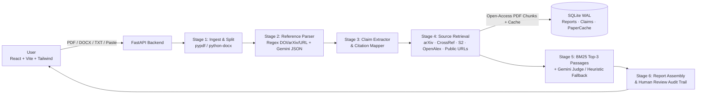

<div align="center">

# PaperProof

### *Don't just cite, prove it.*

**Scientific Claim & Citation Verification System**  
*INNOVEDGE Hackathon 2026 · Problem Statement 03 (CiteVerify) · Team AI INNOVATORS*

[](https://www.python.org/)
[](https://fastapi.tiangolo.com/)
[](https://react.dev/)
[](https://tailwindcss.com/)
[](https://ai.google.dev/)
[](#automated-testing)

[Features](#key-features) • [Architecture](#architecture) • [Pipeline](#6-stage-verification-pipeline) • [Quick Start](#quick-start) • [API](#api-overview) • [Testing](#automated-testing) • [Demo Guide](#2-minute-demo-script)

</div>

---

> [!IMPORTANT]
> **Core Principle:** *"A citation is not proof by itself. This is an automated evidence check, not a final academic judgment. Review every finding."*

**PaperProof** is a full-stack scientific claim and citation verification web application. Upload any academic manuscript, research paper, or student project report (**PDF, DOCX, TXT**) or paste text with a References section, and PaperProof extracts verifiable claims, resolves cited sources from open scholarly databases and official documentation URLs, compares every claim strictly against verbatim source passages, and generates an interactive, human-reviewable audit report.

---

## Key Features

| Capability | Description |
|---|---|
| **Multi-Format Document Ingestion** | Supports **PDF** (with page tracking & scanned-PDF detection), **DOCX** (preserving true paragraph/table order), **TXT**, and pasted text. Raw uploaded bytes are extracted in memory and never stored on disk. |
| **Journal & Student Report Support** | Handles standard `[1]`, `[1–3]`, `(Author, Year)`, and `Author [Year]` citations as well as student mini-project / thesis formats (`CHAPTER 7: REFERENCE`, trailing `APPENDIX / ANNEXURE`, narrative citations like *"Folianto et al. proposed..."*, and bibliography-at-end reports). |
| **4-Source Scholarly Cascade + Web Docs** | Queries **arXiv**, **CrossRef**, **Semantic Scholar**, and **OpenAlex** with SQLite caching, cross-API abstract enrichment, `rapidfuzz` title+year validation, retraction checks, open-access PDF chunking, and an SSRF-protected URL fetcher for official web documentation and government reports. |
| **Anti-Hallucination Evidence Grounding** | Ranks passages with BM25, prompts **Google Gemini** with strict JSON schemas grounded strictly in supplied passages, and **programmatically verifies every `evidence_quote`** as a verbatim substring of the source passage. Automatically falls back to deterministic **heuristic mode** if no API key is set. |
| **Calibrated Confidence & Transparency** | Scales confidence proportionally for abstract-only matches, flags paywalled metadata-only sources honestly for manual review instead of falsely marking them unsupported, and detects retracted or outdated citations. |
| **Interactive Human-in-the-Loop Audit** | Multi-segment verdict Donut chart, clickable filters, misleading-references summary, side-by-side verbatim quote highlighting, persisted `ACCEPTED` / `REJECTED` / `NEEDS REVIEW` decisions with reviewer notes, JSON export, print-ready layout, and toggleable public share links (`/shared/:token`). |

---

## Architecture



---

## 6-Stage Verification Pipeline

1. **Stage 1 — Ingest & Split (`ingest.py`)**  
   Extracts page-numbered text from PDF, DOCX (in true document order), or TXT. Detects image-only/scanned PDFs with clear OCR guidance. Splits body content from `References` / `Bibliography` / `Works Cited` / `CHAPTER N: REFERENCE(S)` and stops before trailing `Appendix` / `Annexure` sections.
2. **Stage 2 — Reference Parsing (`references.py`)**  
   Extracts DOIs, arXiv IDs, and URLs via regex and parses structured `{marker, authors, year, title, venue, doi, arxiv_id, url}` fields using Gemini JSON mode with IEEE/APA regex heuristic fallback.
3. **Stage 3 — Claim Extraction & Mapping (`claims.py`)**  
   Extracts up to 25 prioritized verifiable claims verbatim with page numbers, multi-citation markers (`[1, 2]`, `[1–3]`), and narrative author mentions (*"Longhi et al. developed..."*), skipping cover/certificate boilerplate and flagging missing references or uncited assertions.
4. **Stage 4 — Original Source Retrieval (`retrieve.py`)**  
   Runs a concurrent, SQLite-cached cascade across **arXiv**, **CrossRef**, **Semantic Scholar**, and **OpenAlex** with polite `User-Agent` headers, 429 exponential backoff, cross-API abstract enrichment, retraction detection, open-access PDF chunking, and SSRF-safe public URL retrieval for cited web docs/datasheets.
5. **Stage 5 — Evidence Comparison (`compare.py`)**  
   Uses BM25 to retrieve the top 3 source passages, evaluates claims strictly against those passages in Gemini JSON mode (with deterministic heuristic fallback), programmatically verifies `evidence_quote` verbatim, calibrates confidence for abstract-only sources, and flags paywalled metadata-only sources honestly.
6. **Stage 6 — Report Assembly & Human Review (`runner.py`)**  
   Computes verdict counts, misleading-reference summaries, live progress streaming, persisted human review decisions, JSON export with ethical disclaimer, and toggleable public share links.

### Verdict Taxonomy

| Verdict | Meaning |
|---|---|
| **Supported** | Retrieved source passages clearly and accurately substantiate the claim (including numbers and scope). |
| **Partly Supported** | Cited source relates to the claim but omits/overstates a figure or scope, or only paywalled metadata was accessible (needs human review). |
| **Unsupported** | Retrieved passages do not substantiate the claim, the claim is misattributed to the wrong paper, or it lacks any supporting citation. |
| **Reference Not Found** | Citation marker is missing from the References section, or the cited work could not be located across open databases/URLs. |
| **Contradictory** | Source passages directly state an opposing conclusion or statistic. |
| **Possibly Outdated** | Claim makes a current/state-of-the-art assertion relying on an older source that may be superseded. |

---

## Tech Stack

- **Frontend:** React 18, Vite 6, Tailwind CSS 3.4, React Router 6, Framer Motion, Lucide React
- **Backend:** FastAPI, Uvicorn, SQLAlchemy 2 (SQLite WAL), Pydantic Settings, `httpx`, `pypdf`, `python-docx`, `rapidfuzz`, `google-genai`
- **Auth & Security:** `bcrypt` (12 rounds), JWT (`python-jose`), optional Google OAuth (`email_verified` + audience check), per-user rate limiting, filename sanitization, SSRF URL guard
- **Testing:** `pytest` + FastAPI `TestClient`

---

## Project Structure

```text
PaperProof/
├── backend/
│   ├── app/
│   │   ├── main.py                # FastAPI app, CORS, health check, stale-job recovery
│   │   ├── config.py              # Pydantic settings (loads root .env and backend/.env)
│   │   ├── database.py            # SQLAlchemy engine & SQLite WAL setup
│   │   ├── models.py              # User, Report, Reference, Claim, ReviewDecision, PaperCache
│   │   ├── schemas.py             # Request/response Pydantic schemas
│   │   ├── auth.py                # bcrypt hashing & JWT authentication
│   │   ├── sample_data.py         # Built-in Transformer & BERT benchmark manuscript
│   │   ├── routers/
│   │   │   ├── auth_router.py     # /api/auth/* (signup, login, me, google)
│   │   │   ├── reports_router.py  # /api/verify, /api/sample, /api/reports/*
│   │   │   └── shared_router.py   # /api/shared/{token} (public read-only view)
│   │   └── pipeline/
│   │       ├── ingest.py          # Stage 1: PDF/DOCX/TXT extraction & reference splitting
│   │       ├── references.py      # Stage 2: DOI/arXiv/URL & structured bibliography parsing
│   │       ├── claims.py          # Stage 3: Claim extraction, multi-citation & narrative mapping
│   │       ├── retrieve.py        # Stage 4: 4-API scholarly cascade + SSRF-safe URL fallback
│   │       ├── compare.py         # Stage 5: BM25, Gemini judge, verbatim quote check, heuristic fallback
│   │       ├── llm.py             # Async Gemini client wrapper with retries & model fallback
│   │       └── runner.py          # Stage 6: Concurrent pipeline orchestrator & report assembly
│   ├── tests/
│   │   ├── test_pipeline.py       # 17 unit tests for pipeline stages & guardrails
│   │   └── test_api.py            # 4 API integration tests (auth, isolation, review, share, export)
│   └── requirements.txt
├── frontend/
│   └── src/
│       ├── pages/                 # Home, Verify, Report, History, SharedReport, Login, Signup, etc.
│       ├── components/            # DonutChart, ClaimCard, ConfidenceRing, ProcessingStepper, Navbar
│       ├── context/AuthContext.jsx
│       └── api/client.js
├── .env.example
├── package.json                   # Root scripts: dev, dev:backend, dev:frontend, build:frontend, test:backend
└── README.md
```

---

## Quick Start

### Prerequisites
- **Python 3.11+**
- **Node.js 18+** and **npm**
- *(Optional)* A **Google Gemini API Key** — leave blank to run automatically in deterministic `heuristic` mode

### 1. Configure Environment Variables
Copy `.env.example` to `backend/.env` (or root `.env`) and add your Gemini API key:
```bash
cp .env.example backend/.env
```

### 2. Install & Run Backend (FastAPI + SQLite)
```bash
cd backend
python -m venv .venv

# Windows (PowerShell):
.\.venv\Scripts\Activate.ps1
# macOS / Linux:
source .venv/bin/activate

pip install -r requirements.txt
uvicorn app.main:app --port 8000
```
- Backend API: `http://127.0.0.1:8000`
- Interactive Swagger Docs: `http://127.0.0.1:8000/docs`
- Health Check: `GET http://127.0.0.1:8000/api/health`

### 3. Install & Run Frontend (React + Vite)
```bash
cd frontend
npm install
npm run dev
```
- Frontend App: `http://localhost:5173` *(proxies `/api` to `http://127.0.0.1:8000`)*

### Bonus: Launch Both from the Repo Root
Once both dependencies are installed:
```bash
npm run dev
```

---

## API Overview

| Method | Endpoint | Auth | Purpose |
|---|---|---|---|
| `GET` | `/api/health` | Public | Service health & Gemini configuration status |
| `POST` | `/api/auth/signup` | Public | Create user account and issue JWT |
| `POST` | `/api/auth/login` | Public | Authenticate user and issue JWT |
| `GET` | `/api/auth/me` | Bearer | Current authenticated user profile |
| `POST` | `/api/verify` | Bearer | Upload PDF/DOCX/TXT or submit text to run verification (`202`) |
| `POST` | `/api/sample` | Bearer | Launch built-in Transformer & BERT benchmark manuscript (`202`) |
| `GET` | `/api/reports` | Bearer | List user's verification history |
| `GET` | `/api/reports/{id}/status` | Bearer | Poll live stage, progress percentage, and partial claims |
| `GET` | `/api/reports/{id}` | Bearer | Full verification report with claims, quotes, references & audit trail |
| `POST` | `/api/reports/{id}/rerun` | Bearer | Re-run verification pipeline on a previous report |
| `PATCH` | `/api/reports/{id}/claims/{claim_id}/review` | Bearer | Persist human review decision (`accepted` / `rejected` / `needs_review`) + note |
| `POST` | `/api/reports/{id}/share` | Bearer | Toggle public read-only share link |
| `GET` | `/api/reports/{id}/export.json` | Bearer | Download structured audit report JSON with ethical disclaimer |
| `GET` | `/api/shared/{token}` | Public | View a publicly shared read-only report |

---

## Automated Testing

Run the full backend test suite (**21 unit & integration tests** covering ingestion, reference splitting, IEEE/APA parsing, narrative citations, SSRF guard, BM25, verbatim quote anti-hallucination verification, auth isolation, review decisions, public sharing, and JSON export):

```bash
npm run test:backend
# or from backend/:
pytest -v
```

Verify the production frontend bundle:
```bash
npm run build:frontend
```

---

## Security, Privacy & Ethical Safeguards

- **In-Memory Uploads:** Uploaded PDF/DOCX/TXT files are parsed in memory and raw bytes are never persisted to disk.
- **SSRF Protection:** Public reference URL retrieval blocks `localhost`, private/loopback/link-local IP ranges, and non-HTTP schemes.
- **Auth & Tenant Isolation:** Passwords hashed with `bcrypt` (12 rounds); every report endpoint enforces per-user ownership checks (`404` across users).
- **Honest Uncertainty Reporting:** Abstract-only comparisons scale confidence proportionally and display an explicit coverage note; paywalled metadata-only sources are flagged for manual review rather than falsely labeled unsupported.
- **Scanned PDF Detection:** Image-only PDFs without a text layer return actionable OCR guidance instead of silently failing.

---

## 2-Minute Demo Script

1. **Landing Page (`/`, 20s):** Explore the editorial academic UI and click through the **Interactive Evidence Preview** (*Supported* vs. *Partly Supported* vs. *Unsupported*).
2. **Sign Up & Verify (`/signup` → `/verify`, 20s):** Create an account and click **Try sample document** (or upload any PDF/DOCX research paper or student mini-project report).
3. **Live Pipeline Stepper (`/report/:id`, 25s):** Watch real-time progress across *Upload → Extract → Retrieve → Compare → Report* as cited sources are fetched and verified.
4. **Interactive Report & Human Review (40s):**
   - Inspect the interactive multi-segment **Donut Chart**, calibrated **Confidence Rings**, and **Misleading References** panel.
   - Click **Side-by-Side** on any claim to inspect the verbatim highlighted quote inside the retrieved source passage.
   - Record **Accepted** / **Needs Review** / **Rejected** decisions with reviewer notes and watch the **Review History** sidebar update live.
5. **Export, Share & History (15s):** Export the report via **Download JSON**, toggle **Share** to open a public read-only `/shared/:token` link, and open **History** to compare past runs or re-run with one click.
